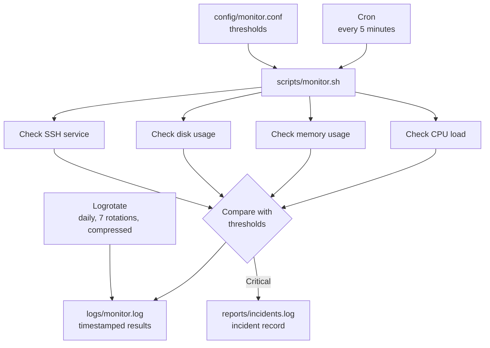

# Linux Server Health & Incident Monitoring System


A lightweight, Bash-based monitoring tool for Ubuntu servers. It checks CPU load, memory usage, disk usage and SSH service health against configurable thresholds, writes timestamped logs, records critical incidents, and runs unattended through Cron with automatic log rotation.

Built with Bash and standard Linux utilities, it relies on Cron for scheduling and Logrotate for log management. Both are typically available on Ubuntu, and no additional third-party packages are required.

---

## Table of Contents

1. [Project Overview](#project-overview)
2. [Key Features](#key-features)
3. [Architecture](#architecture)
4. [Project Structure](#project-structure)
5. [Technologies Used](#technologies-used)
6. [How the Monitoring System Works](#how-the-monitoring-system-works)
7. [Installation and Setup](#installation-and-setup)
8. [Configuration Guide](#configuration-guide)
9. [Running the Monitoring Script](#running-the-monitoring-script)
10. [Cron Job Setup](#cron-job-setup)
11. [Logrotate Configuration](#logrotate-configuration)
12. [Sample Monitoring Output](#sample-monitoring-output)
13. [Incident Reporting](#incident-reporting)
14. [Error Handling](#error-handling)
15. [Testing and Validation](#testing-and-validation)
16. [Troubleshooting](#troubleshooting)
17. [Future Improvements](#future-improvements)
18. [Author](#author)

---

## Project Overview

Servers fail quietly: disks fill up, memory is exhausted, load climbs, and services stop. This project automates the routine checks an administrator would otherwise run by hand.

On every run, the script reads its thresholds from a central configuration file, measures the current state of the system, classifies each resource as normal, warning or critical, and writes the result to a timestamped log. Critical conditions are also written to a separate incident log. Cron triggers the script every five minutes, and Logrotate keeps the log files from growing without limit.

**What this project demonstrates:** Bash scripting, Linux system administration, task scheduling, log management, configuration-driven design and defensive error handling.

---

## Key Features

| Area | Capability | Status |
|------|------------|--------|
| Monitoring | CPU load monitoring using Linux system information | Implemented |
| Monitoring | Memory usage monitoring | Implemented |
| Monitoring | Disk usage monitoring | Implemented |
| Monitoring | SSH service/process health check | Implemented |
| Configuration | Warning and critical thresholds in `config/monitor.conf` | Implemented |
| Logging | Timestamped monitoring log (`logs/monitor.log`) | Implemented |
| Incidents | Critical incident reporting (`reports/incidents.log`) | Implemented |
| Reliability | Configuration checks and log-writing error handling | Implemented |
| Automation | Scheduled execution with Cron every 5 minutes | Implemented |
| Log management | Logrotate with compression and 7-rotation retention | Implemented |
| Quality | Bash script syntax validation | Implemented |

> This project does **not** currently send email, SMS or any other external alerts. Incidents are recorded to local files only. See [Future Improvements](#future-improvements).

---

## Architecture



---

## Project Structure

```text
linux-server-monitor/
├── config/
│   ├── monitor.conf                  # Warning and critical thresholds
│   └── logrotate/
│       └── linux-server-monitor      # Logrotate configuration
├── logs/
│   └── .gitkeep                      # Keeps the directory in Git; monitor.log is written here
├── reports/
│   └── .gitkeep                      # Keeps the directory in Git; incidents.log is written here
├── scripts/
│   └── monitor.sh                    # Main monitoring script
├── tests/                            # Test directory
├── README.md
└── .gitignore
```

---

## Technologies Used

| Technology | Purpose |
|------------|---------|
| Linux (Ubuntu) | Target operating system |
| Bash scripting | Monitoring logic, threshold comparison, logging |
| Linux system utilities | Reading CPU, memory, disk and service information |
| Cron | Scheduled execution every 5 minutes |
| Logrotate | Log rotation, compression and retention |
| Git and GitHub | Version control and hosting |

---

## How the Monitoring System Works

1. **Trigger.** Cron starts `scripts/monitor.sh` every five minutes (or you run it manually).
2. **Configuration.** The script checks that `config/monitor.conf` exists and is readable, then loads the thresholds and validates them.
3. **Measurement.** It collects CPU load, memory usage, disk usage and SSH service status using standard Linux utilities.
4. **Evaluation.** Each value is compared with its warning and critical threshold.
5. **Logging.** Every result is written to `logs/monitor.log` with a timestamp. If the script cannot write to the log, it reports the failure.
6. **Incident recording.** Critical conditions are also recorded in `reports/incidents.log` with a timestamp, the affected resource, the measured value and a critical status.
7. **Housekeeping.** Logrotate rotates and compresses `logs/monitor.log` daily and keeps 7 rotated copies.

### Threshold Levels

| Level | Meaning |
|-------|---------|
| Normal | Value is below the warning threshold |
| Warning | Value has reached the warning threshold |
| Critical | Value has reached the critical threshold; an incident is recorded |

---

## Installation and Setup

### Prerequisites

- Ubuntu (or another Debian-based Linux distribution)
- Bash
- Standard Linux utilities (used by the script to read system information)
- Git
- Cron (typically preinstalled; see [Cron Job Setup](#cron-job-setup) to enable it)
- Logrotate (typically preinstalled on Ubuntu; see [Logrotate Configuration](#logrotate-configuration) to install the project's configuration)

### Steps

Clone the repository into a folder named `linux-server-monitor` (this matches the paths used in the Cron example below):

```bash
git clone https://github.com/AbhishekThite387/linux-server-health-monitor.git linux-server-monitor
cd linux-server-monitor
```

Review the thresholds and adjust them for your server:

```bash
nano config/monitor.conf
```

Confirm the script has no syntax errors:

```bash
bash -n scripts/monitor.sh
```

---

## Configuration Guide

All thresholds are defined in `config/monitor.conf`:

```bash
WARNING_LOAD=2.0
CRITICAL_LOAD=4.0
WARNING_MEMORY=80
CRITICAL_MEMORY=90
WARNING_DISK=80
CRITICAL_DISK=90
```

| Variable | Resource | Unit | Default | Meaning |
|----------|----------|------|---------|---------|
| `WARNING_LOAD` | CPU load | Load average | `2.0` | Warning when load reaches this value |
| `CRITICAL_LOAD` | CPU load | Load average | `4.0` | Critical when load reaches this value |
| `WARNING_MEMORY` | Memory | Percent used | `80` | Warning when usage reaches this value |
| `CRITICAL_MEMORY` | Memory | Percent used | `90` | Critical when usage reaches this value |
| `WARNING_DISK` | Disk | Percent used | `80` | Warning when usage reaches this value |
| `CRITICAL_DISK` | Disk | Percent used | `90` | Critical when usage reaches this value |

### Tuning Tips

- CPU load is relative to the number of CPU cores. A load of `4.0` is much more serious on a 1-core server than on an 8-core server. Check your core count with `nproc` and set the load thresholds accordingly.
- Keep each warning threshold lower than its matching critical threshold.
- Example for a stricter disk policy: set `WARNING_DISK=70` and `CRITICAL_DISK=85`.

---

## Running the Monitoring Script

Run the script manually from the project root:

```bash
bash scripts/monitor.sh
```

View the most recent log entries:

```bash
tail -n 20 logs/monitor.log
```

View recorded incidents:

```bash
cat reports/incidents.log
```

---

## Cron Job Setup

Cron runs the script automatically every five minutes.

Enable the Cron service so it starts now and on every boot:

```bash
sudo systemctl enable --now cron
```

Confirm that the service is running:

```bash
systemctl status cron
```

Open the crontab editor:

```bash
crontab -e
```

Add this entry (adjust the path if your project is in a different location):

```cron
*/5 * * * * /bin/bash /home/ubuntu/linux-server-monitor/scripts/monitor.sh
```

Verify that the entry was saved:

```bash
crontab -l
```

### Cron Entry Explained

| Part | Meaning |
|------|---------|
| `*/5` | Every 5 minutes |
| `* * * *` | Every hour, day of month, month and day of week |
| `/bin/bash` | Interpreter used to run the script |
| `/home/ubuntu/linux-server-monitor/scripts/monitor.sh` | Absolute path to the monitoring script |

Cron does not run in your project directory, so always use absolute paths in the entry.

---

## Logrotate Configuration

Logrotate prevents `logs/monitor.log` from growing indefinitely. The project's configuration is stored in:

`config/logrotate/linux-server-monitor`

| Setting | Effect |
|---------|--------|
| Daily rotation | The log is rotated once per day |
| Retention of 7 rotated logs | Older backups beyond seven are removed |
| Compression | Rotated logs are compressed to save disk space |
| Delayed compression | The most recent rotated log stays uncompressed until the next rotation |
| Copy and truncate | The log is copied, then emptied in place, so the script keeps writing to the same file |

Ubuntu's `logrotate.timer` runs Logrotate automatically, so no extra Cron entry is needed for rotation.

### Install the Configuration

Logrotate reads its configuration files from `/etc/logrotate.d/`. Copy the project's configuration there:

```bash
sudo cp config/logrotate/linux-server-monitor /etc/logrotate.d/linux-server-monitor
```

### Validate the Installed Configuration

Run Logrotate in debug mode against the installed file. This shows what would happen without rotating or changing any files:

```bash
sudo logrotate -d /etc/logrotate.d/linux-server-monitor
```

---

## Sample Monitoring Output

> **PLACEHOLDER SECTION:** The output blocks and screenshots below are placeholders, not real output. They will be replaced with actual terminal output and screenshots from a real run. The exact log format is defined by `scripts/monitor.sh`.

**Terminal output from a manual run (placeholder):**

```text
[PLACEHOLDER - output of: bash scripts/monitor.sh]
```

**Log file contents (placeholder):**

```text
[PLACEHOLDER - output of: tail -n 20 logs/monitor.log]
```

**Screenshot placeholders (no screenshots added yet):**

| Screenshot | Description | Status |
|------------|-------------|--------|
| `docs/images/monitor-run.png` | Manual script run in the terminal | Placeholder |
| `docs/images/monitor-log.png` | Contents of `logs/monitor.log` | Placeholder |
| `docs/images/cron-entry.png` | `crontab -l` showing the 5-minute schedule | Placeholder |

---

## Incident Reporting

When a resource reaches its critical threshold, the script records an incident in:

`reports/incidents.log`

Each incident entry contains:

| Field | Description |
|-------|-------------|
| Timestamp | When the incident was detected |
| Affected resource | CPU load, memory or disk |
| Measured value | The value that crossed the threshold |
| Status | Critical |

Incidents are stored locally in this file. The project does not send notifications.

**Screenshot placeholder (no screenshot added yet):** `docs/images/incidents-log.png` showing the contents of `reports/incidents.log`.

---

## Error Handling

| Condition | Handling |
|-----------|----------|
| Configuration file missing | Checked before monitoring starts |
| Configuration file not readable | Checked before monitoring starts |
| Invalid threshold values | Validated before they are used |
| Log file cannot be written | The failure is reported instead of being silently ignored |

---

## Testing and Validation

**Syntax validation** (no code is executed):

```bash
bash -n scripts/monitor.sh
```

**Functional checks performed on the project:**

| Check | Result |
|-------|--------|
| Bash syntax validation | Implemented |
| Manual script execution | Implemented and tested |
| Scheduled execution through Cron | Implemented and tested |
| Incident reporting | Implemented and tested |
| Error handling | Implemented and tested |
| Log rotation | Implemented and tested |

**Try it yourself:** temporarily lower a threshold in `config/monitor.conf` (for example, set `CRITICAL_DISK` below your current disk usage), run the script, and confirm a critical entry appears in `reports/incidents.log`. Restore the original value afterwards.

The `tests/` directory is reserved for test scripts.

---

## Troubleshooting

| Problem | Possible cause | What to check |
|---------|----------------|---------------|
| Script does not run from Cron | Wrong path in crontab | Run `crontab -l` and confirm the absolute path is correct |
| No new log entries | Cron not running or script failing | Run `systemctl status cron`; if inactive, run `sudo systemctl enable --now cron`; then run the script manually |
| Permission error writing logs | The user cannot write to `logs/` or `reports/` | Check ownership with `ls -ld logs reports` |
| Configuration error on start | `monitor.conf` missing, unreadable or invalid values | Check the file exists, is readable and contains valid numeric thresholds |
| Syntax error | Script was edited incorrectly | Run `bash -n scripts/monitor.sh` |
| Logs not rotating | Logrotate config not installed or timer inactive | Confirm `/etc/logrotate.d/linux-server-monitor` exists, run `sudo logrotate -d /etc/logrotate.d/linux-server-monitor`, and check `systemctl status logrotate.timer` |
| Too many warnings | Thresholds too low for the hardware | Adjust values in `config/monitor.conf`, especially load relative to `nproc` |

---

## Future Improvements

The items below are **not implemented**. They are ideas for future development.

- [ ] External alerting (for example, email or chat notifications)
- [ ] Monitoring of additional services beyond SSH
- [ ] Automated test suite in the `tests/` directory
- [ ] A one-step install script for Cron and Logrotate setup
- [ ] Monitoring of additional metrics (for example, swap or network usage)
- [ ] Multi-server support
- [ ] Continuous integration checks (for example, ShellCheck on every push)

---

## Author

**Abhishek Thite**

GitHub: [AbhishekThite387](https://github.com/AbhishekThite387)

Project repository: [linux-server-health-monitor](https://github.com/AbhishekThite387/linux-server-health-monitor)
